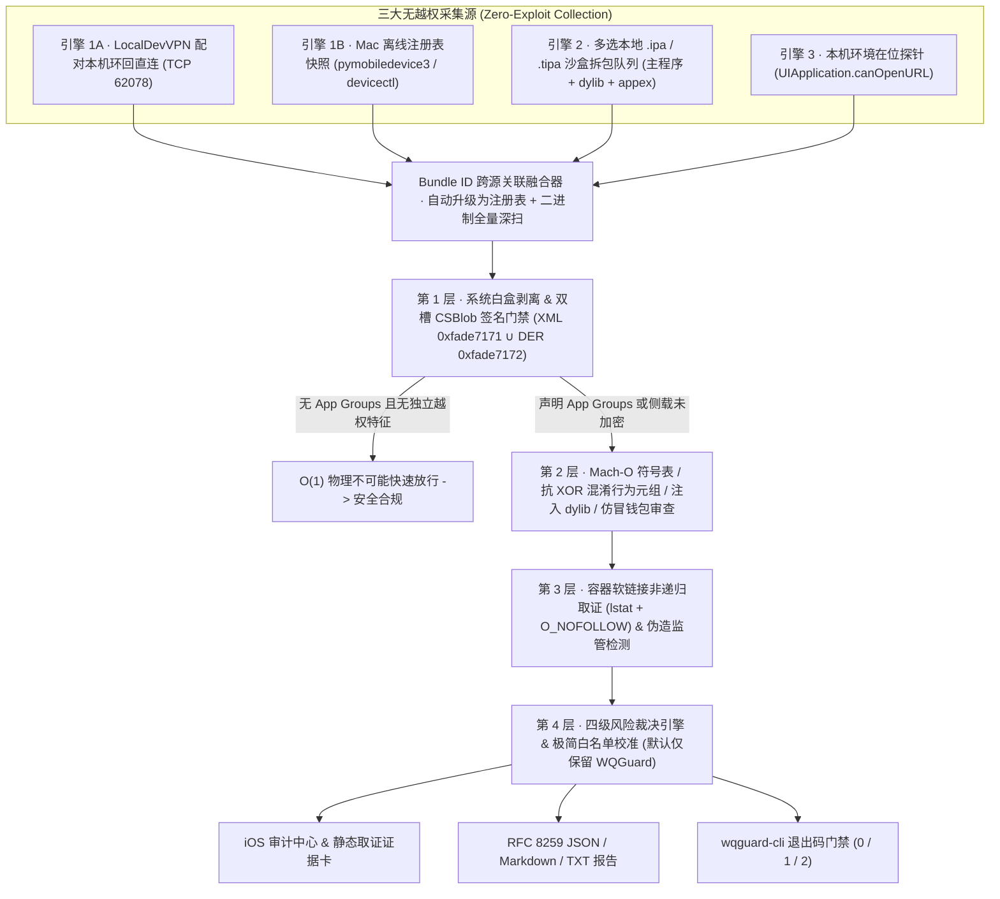

<div align="center">

# 🛡️ WQGuard

**面向 iOS 26.2+ / iOS 27.x 的零依赖、100% 物理只读沙盒逃逸检测引擎、Mach-O 静态二进制审计与多端固件 CVE 防护系统**  
**Zero-Dependency, 100% Read-Only iOS Sandbox Escape Detector, Mach-O Static Binary Analyzer & Multi-Client Firmware CVE Guard**

[](https://github.com/Kianuni/WQGuard/releases/latest)
[](LICENSE)
[%20%7C%20macOS-lightgrey.svg)]()
[]()
[]()
[]()
[](SECURITY.md)

**[🇨🇳 简体中文](#简体中文) · [🇺🇸 English](#english) · [📥 下载 IPA 与护盾规则](https://github.com/Kianuni/WQGuard/releases/latest) · [🔒 安全不变量规范](SECURITY.md) · [📖 底层技术白皮书](USAGE_GUIDE.md)**

</div>

---

<a name="简体中文"></a>
## 🇨🇳 简体中文

### 目录
- [1. 项目定位与自研底层引擎矩阵](#1-项目定位与自研底层引擎矩阵)
- [2. 系统全景数据流架构](#2-系统全景数据流架构)
- [3. 核心攻防原理解剖（WQGuard 如何对抗 0day 与混淆绕过）](#3-核心攻防原理解剖wqguard-如何对抗-0day-与混淆绕过)
- [4. 零信任安全与物理只读策略](#4-零信任安全与物理只读策略)
- [5. 扫描管线、完整威胁特征库与四级裁决矩阵](#5-扫描管线完整威胁特征库与四级裁决矩阵)
- [6. 固件 CVE 暴露雷达与五大代理客户端防 Brotli 护盾](#6-固件-cve-暴露雷达与五大代理客户端防-brotli-护盾)
- [7. 红蓝对抗测试体系与性能基准](#7-红蓝对抗测试体系与性能基准)
- [8. 仓库源码拓扑结构](#8-仓库源码拓扑结构)
- [9. 快速上手与命令行实战指南](#9-快速上手与命令行实战指南)

---

### 1. 项目定位与自研底层引擎矩阵

**WQGuard（容器守卫）** 是一套完全使用原生 Swift（`swift-tools-version: 5.9`）与 Darwin POSIX 系统接口从零手写构建的 **iOS 侧载安全审计与固件漏洞缓解系统**，无任何第三方库或 C 桥接外部依赖。项目由三大生产级交付物组成：

1. **iOS 原生审计终端 (`WQGuard.app`)**：支持**三引擎无越权全机已安装应用盘点**、**多选 `.ipa` / `.tipa` 离线沙盒 Mach-O 静态二进制审计**、**2026 固件 CVE 暴露评估雷达**、**五大代理软件（Surge / 小火箭 / 圈 X / Loon / Stash）防 Brotli 溢出护盾一键唤起导入**，以及符合 RFC 8259 标准的 JSON / Markdown / 纯文本取证报告导出。
2. **macOS 原生命令行工具 (`wqguard-cli`)**：面向安全研究员、备份取证与 CI/CD 自动化流水线的单文件 Darwin 可执行程序，支持严格流纯净度控制（非 TTY 零 ANSI 污染）与分级退出码门禁（`0` 合规 / `1` 检出高危 / `2` 参数或 I/O 异常）。
3. **独立多端网络层 CVE 护盾规则集 ([`Shields/`](Shields/))**：开箱即用的 HTTP 传输层请求头降级重写与零响应体解压熔断规则，在不升级系统的前提下拦截 `CVE-2026-111497` (`HTTP2Shell`, CVSS 9.2) 远程堆越界写核心 HTTP `br` 压缩流。

#### 🛠️ 七大零依赖自研底层解析器与协议引擎

不同于依赖现成脚本或系统高危越权接口的套壳工具，WQGuardCore 内置了 7 套针对恶意畸形样本做过算术溢出加固的底层解析器：

| 核心模块 | 源码位置 | 底层技术实现与二进制协议细节 |
|---|---|---|
| **Mach-O 64/Fat 静态二进制分析器** | `MachO/MachOParser.swift` | 原生解析 32/64 位 Mach-O (`0xfeedfacf` / `0xfeedface`) 与通用胖二进制 `FAT_MAGIC` / `FAT_MAGIC_64` (`0xcafebabe` / `0xbebafeca` / `0xcafebabf`，硬上限 1024 切片防切片炸弹)；对全部 iOS ARM 切片（`arm64` + `arm64e`）取并集防多切片遮蔽，遍历 `LC_SYMTAB`、`LC_LOAD_DYLIB`、`LC_ENCRYPTION_INFO_64` (`cryptid`)、未加密 `__objc_methname` Selector 表与 `__TEXT` 字符串，全程执行 64 位无溢出边界检查 |
| **双槽 `CSBlob` 签名状态机** | `MachO/CSBlobParser.swift` | 解析 `LC_CODE_SIGNATURE` 超级块 (`0xfade0cc0`)，同时解码 **Slot 5 XML 权限表 (`0xfade7171`)** 与 **Apple `CoreEntitlements` v1 规范（`[APPLICATION 16]` `0x70` + `[CONTEXT 16]` `0xb0` + ITU-T X.690 多字节高标签）Slot 7 ASN.1 DER (`0xfade7172`)**，无遮蔽合并完整权限字典并覆盖每个独立 `PlugIns/*.appex` / `Extensions/*.appex` 插件签名 |
| **纯 Swift `lockdownd` 协议栈** | `Engine/LockdownInstProxyClient.swift` | 零 `libimobiledevice` / `OpenSSL` 依赖，基于原生套接字与内存 PKCS#12 证书身份实现 `TCP 62078` 握手、严格校验叶子证书指纹与根 CA 链（Fail-Closed）的 `StartSession` TLS 升级及 4 字节大端帧封装的 `com.apple.mobile.installation_proxy` (`Browse`) 查询 |
| **`CSStore2` 数据库引擎** | `CSStore/CSStore2Parser.swift` | 只读内存映射解析 LaunchServices `"bdsl"` 二进制缓存（兼容 **iOS 26 与 iOS 27 双代记录偏移布局**，上限保护 `16M` 字符串 ID / `100,000` 包记录，内置 BiDi 控制符剥离）；面向 **macOS 主机/备份取证 (`wqguard-cli --scan-system`) 与 `no-sandbox` 研究环境** |
| **MCM 容器元数据与软链取证** | `CSStore/MCMReader.swift` / `ContainerScanner.swift` | 强制以 `open(O_RDONLY \| O_NOFOLLOW \| O_CLOEXEC)` 读取容器元数据并以 `lstat` + `readlink` 非递归识别越界软链接（面向 **macOS 备份目录、`--container` 审计与越狱/巨魔 `no-sandbox` 环境**；标准非越狱沙盒下由三引擎注册表与 `.ipa` 审计接管） |
| **按需隔离拆包 `.ipa` / `.tipa` 审查器** | `Engine/IPAPackageScanner.swift` | 校验 ZIP / ZIP64 中央目录结构，按需提取二进制与签名文件（自动跳过图片/音视频大体积静态资产）至独立 `tmp/wqguard_ipa_<UUID>/` 沙盒并由 `defer` 销毁；内置路径分段级 **Zip-Slip (`../`) 拦截**、`S_IFLNK` 符号链接条目剥离与 64 KB 流式分块防伪造头部解压炸弹；深扫主程序、`Frameworks/`、`Dylibs/`、`DynamicLibraries/` 及全部 `PlugIns/*.appex` / `Extensions/*.appex` |
| **多端代理规则编译器** | `Engine/SurgeBrotliShieldHelper.swift` | 按各代理内核语法规范生成并校验 `.sgmodule` (`script-path=`) / `.module` / `.conf` / `.plugin` / `.stoverride` 配置与大小写/重复头无关的顶层 `HTTP 403` 零解压响应熔断脚本，强制校验 16 项核心证书锁定负向排除规则完整性 |

---

### 2. 系统全景数据流架构



---

### 3. 核心攻防原理解剖（WQGuard 如何对抗 0day 与混淆绕过）

#### 3.1 两阶段沙盒逃逸攻击链解剖 (`bad_query` + `worse_query`)
在 iOS Seatbelt 强制访问控制架构下，第三方应用被严格限制在各自的随机 UUID 容器内，内核策略显式禁止跨容器枚举 `/private/var/mobile/Containers`。自 iOS 26.0 延续至 iOS 27.x 的未修补沙盒逃逸利用链通过两个阶段突破隔离：

1. **阶段一 · APFS Inode 暴力反查路径泄露 (`bad_query` / `fsgetpath`)**：
   攻击者无法对 `/Containers/Data/Application` 调用 `readdir()`，但早期 Seatbelt 策略未封堵底层 BSD 系统调用 `fsgetpath(char *buf, size_t buflen, fsid_t *fsid, uint64_t ino)`。恶意应用从 `ino = 1` 遍历至数千万号段，直接查询内核 APFS Object Map 反推真实路径，从而获知受害者应用（如加密钱包、聊天软件）的随机容器 UUID。
2. **阶段二 · `containermanagerd` 混淆替身软链接穿越 (`worse_query`)**：
   获取到目标路径后，恶意应用调用私有库 `libsystem_containermanager.dylib`，向高权限守护进程 `containermanagerd` 请求自身合法拥有的 `App Group` 共享容器（`Class = 7`，子路径 `Part = 3` 即 `Library/Caches`，操作标志位 `0x0000008000000000ULL`），同时在竞态窗口内将 `<OwnAppGroup>/Library/Caches` 掉包为指向受害者容器的符号链接：
   ```c
   // 攻击者利用 containermanagerd 缺少路径前缀回落校验，诱导内核签发任意目录读写令牌：
   // containermanagerd 内部误对逃逸后的目标路径执行：
   sandbox_extension_issue_file("com.apple.app-sandbox.read-write", resolvedVictimPath, 0);
   // 攻击者随后调用 sandbox_extension_consume(token) 直接获得受害者容器完整读写权限！
   ```
3. **WQGuard 的密码学不可能门禁定理（Cryptographic Impossibility Gate）**：
   `containermanagerd` 在处理任何容器请求的最前端，会强制核验调用方内核代码签名中的 `com.apple.security.application-groups`。**任何未在签名权限表中声明 `App Group` 的进程，请求会被 `containermanagerd` 立即以错误码 `-1` 物理拒绝**。WQGuard 在前置核验无需 App Group 的独立越权原语（如 `fsgetpath` `bad_query` 侦察系统调用与仿冒钱包特征）之后，对未声明 App Group 的纯净应用在常数时间 $O(1)$ 内完成安全放行，同时对每个独立签名的 `PlugIns/*.appex` 与 `Extensions/*.appex` 扩展进程单独核验 `CSBlob`，封死小组件跳板绕过。

#### 3.2 粉碎「双槽 `CSBlob` 权限遮蔽」签名绕过攻击
在嵌入式 Mach-O 代码签名超块（`CSMAGIC_EMBEDDED_SIGNATURE = 0xfade0cc0`）中，权限信息同时存在于两个独立槽位：
- **Slot 5 (`0xfade7171`)**：传统 XML Property List 格式（常规静态脚本默认仅读此槽）；
- **Slot 7 (`0xfade7172`)**：iOS 内核 AMFI（AppleMobileFileIntegrity）与 `CoreEntitlements` 实际优先采信的 **ASN.1 DER 编码权限树**（顶层封装于 `[APPLICATION 16]` `0x70` + 版本号 `INTEGER 1` + `[CONTEXT 16]` `0xb0` 构造容器内）。

**恶意绕过手法**：高阶恶意侧载包故意在 Slot 5 塞入一份空白无害的 XML `<dict/>`（或显式写入 `<false/>` / `<array/>` 占位符）欺骗静态扫描器，而将恶意 `com.apple.security.application-groups` 或 `com.apple.private.photos.*` 藏匿于 Slot 7 真实 Apple DER 二进制流中。  
**WQGuard 反制方案**：`CSBlobParser.swift` 内置完整支持 ITU-T X.690 构造标签（`0x30` SEQUENCE、`0x31` SET、`0x70` `[APPLICATION 16]`、`0xb0` `[CONTEXT 16]` 及多字节高标签）的 ASN.1 DER 递归解析器，**遍历全部可执行 ARM 切片及超块索引槽位，对 XML 与 DER 完整权限字典执行防遮蔽并集合并（Union）**，经真实 `/usr/bin/codesign --generate-entitlement-der` 对拍回归验证，任何单槽隐藏或槽位遮蔽均无所遁形。

#### 3.3 `HTTP2Shell` (`CVE-2026-111497`) 与 iOS 网络扩展 50MB 内存墙工程博弈
`CVE-2026-111497` 是系统底层 `libbrotli` 解码器在处理畸形 HTTP `Content-Encoding: br` 数据流时的堆缓冲区越界写入漏洞（CVSS 9.2）。在未升级固件的设备上通过代理工具缓解该漏洞面临两大工程陷阱：
1. **陷阱一 · 响应体解压自爆**：若代理脚本开启 `requires-body=true` 检查响应内容，代理进程自身会先调用系统解压库或将大文件载入内存——而 iOS 给网络扩展进程（`NEPacketTunnelProvider`）设定的 **Jetsam 物理内存硬上限仅有约 50MB**，一旦遇到视频流或大体积载荷就会瞬间触发 OOM 崩溃断网。
2. **陷阱二 · 证书锁定（SSL Pinning）误伤**：若将 MITM 主机名盲目拦截 Apple 与金融域名，Apple Intelligence 私有云计算 PCC、普通话 Siri `guzzoni.apple.com`、iCloud 及网银客户端会因校验证书公钥指纹不匹配而断连重连发热。

**WQGuard 护盾架构与明确协议边界**：
- **正向降级 + 零解压顶层 `HTTP 403` 熔断**：去程重写 `Accept-Encoding: gzip, deflate` 从源头阻止合规服务器下发 `br` 流；回程采用 **`requires-body=false` / `script-response-header` 纯响应头状态机**（[`brotli-guard.js`](Shields/scripts/brotli-guard.js)），大小写与重复响应头无关地扫描全部 `Content-Encoding` 字段，不触碰一字节响应体即可将无视协商强推 `br` 的响应直接熔断为顶层 `HTTP 403 Forbidden`。
- **16 项负向排除 + 21 类高危钓鱼后缀（支持 `*` 全量扩展）**：默认 MITM 黑产投毒最高发的 21 类廉价顶级域（`*.xyz`、`*.top`、`*.icu`、`*.click`、`*.zip`、`*.mov` 等）实现日常零额外耗电；如需覆盖 `.com` / `.net` 全量网页浏览，可将模块参数 `EXTRA_MITM_HOSTS` 设为 `*`（16 项负向排除置顶生效，依然严格保护 Apple 核心服务与金融支付）。
- **专业防御边界提示（WOFF2 网页字体与 HTTP/3 QUIC）**：HTTP 代理改写仅作用于经 MITM 解密的 HTTP/1.1 与 HTTP/2 `Accept-Encoding` 响应流；WebKit CSS `@font-face` 加载的 **`.woff2` 网页字体内置独立 Brotli 解码**及未走代理 MITM 的 **HTTP/3 QUIC** 不受 `Accept-Encoding` 控制。**针对高危定向攻击场景，建议在启用本护盾的同时禁用代理端 QUIC/UDP 443，并叠加开启系统「设置 → 隐私与安全性 → 锁定模式（Lockdown Mode）」以在 WebKit 层彻底禁用自定义 WOFF2 字体渲染**。

---

### 4. 🔒 零信任安全与物理只读策略

作为审计本机敏感注册表与未知第三方安装包的防守方工具，WQGuard 严格兑现以下工程安全边界（完整规范见 [SECURITY.md](SECURITY.md)）：

- **100% 本机离线闭环 · 零遥测零上传**：工程不包含任何网络分析、统计埋点或远端 API 调用。用户导入的 `.mobiledevicepairing` 配对记录、`installed_apps.json` 快照与本地 `.ipa` 扫描列表严格封闭在应用私有沙盒 `Application Support/WQGuardRegistry/` 内，支持随时一键销毁；`LocalDevVPN` 配对扫描全程仅与手机自身 `lockdownd` 进行严格校验证书（Fail-Closed）的本机环回通信，绝无一字节流出设备。
- **第三方侧载工具严格零信任（Strict Zero-Trust on Sideloading Tools）**：WQGuard **绝不为任何第三方侧载签名器、证书管理器或本地调试隧道预置隐式白名单豁免**（包括 `Feather`、`SideStore`、`AltStore`、`全能签 / ESign`、`GBox`、`Scarlet`、`LocalDevVPN`、`StikDebug`、`TrollStore` 等均不会自动标为 `Known Tool`，即使未声明 `App Groups` 亦客观呈现为 `🟠 前置留意` 或 `🔴 高危`）。出厂内置白名单仅校验 `WQGuard` 自身精确签名、全部 App Group 精确归属与只读自检字符串子集，任何冒用 `com.wqguard.app` 却夹带越权特征或寄生外部 App Group 的木马均会被立即拦截。
- **零主动漏洞利用（Zero-Exploit）**：绝不调用 `worse_query` 或 `fsgetpath` 去暴力枚举其他容器，彻底杜绝因扫描引发的 `0x8badf00d` 看门狗超时强杀、`containermanagerd` 守护进程异常或残留软链接风险。
- **内核级物理只读锁死（`O_RDONLY | O_NOFOLLOW | O_CLOEXEC`）**：
  - 所有底层文件读取强制携带 `O_RDONLY` 与 `O_NOFOLLOW`，遇到恶意符号链接内核直接返回 `ELOOP` 拒绝跟随；
  - 容器排查统一使用 `lstat()` + `readlink()` 原位取证并立即终止对该分支递归；
  - 二进制解析采用 `.mappedIfSafe` (`PROT_READ`) 只读内存页映射；
  - 通过线程安全 RAII 包装器 `ScopedSandboxToken` 及时释放沙盒扩展槽位，防止大批量扫描耗尽 Darwin 进程槽位（错误码 `-6` / `EXFULL`）；
  - `.ipa` / `.tipa` 按需提取工作于随机 UUID 临时沙盒目录 `wqguard_ipa_<UUID>/`（自动剥离压缩包内 `S_IFLNK` 符号链接条目），由 `defer` 保证函数退出时 100% 销毁无残留。

---

### 5. 扫描管线、完整威胁特征库与四级裁决矩阵

#### 5.1 内置静态与启发式威胁特征全表 (`SignatureCatalog` + `ExpandedThreatCatalog`)

| 规则标识 / 类别 | 检测目标特征（符号 / Dylib / XPC / 行为元组） | 检索位置 | 风险定级 | 对应攻击向量说明 |
|---|---|---|---|---|
| `DYLIB_CONTAINERMANAGER` | `libsystem_containermanager.dylib` | `LC_LOAD_DYLIB` | 🔴 高危 | 直接链接私有容器管理动态库以发起跨沙盒令牌请求 |
| `SYM_QUERY_CREATE` 等 (11 项) | `container_query_create` / `set_group_identifiers` / `operation_set_part` / `operation_set_flags` / `copy_sandbox_token` / `sandbox_extension_consume` 等 | `LC_SYMTAB` (全 ARM 切片) | 🔴 高危 | `worse_query` 混淆替身沙盒逃逸核心私有 API 调用链 |
| `XPC_CONTAINERMANAGERD` | `com.apple.containermanagerd` / `.system` | `__TEXT,__cstring` | 🔴 高危 | 绕过 C 封装层、直接通过底层 XPC Mach 服务通信触发容器越权 |
| `SYM_FSGETPATH` | `fsgetpath` / `container_object_get_path` | `LC_SYMTAB` (免 App Group 前置检出) | 🔴 高危 | `bad_query` / `pathleak` APFS 64 位 Inode 暴力枚举容器 UUID 路径 |
| `TUPLE_OBFUSCATED_EXPLOIT` | `cryptid==0 ∧ AppGroups ∧ (dlopen/dlsym) ∧ (symlink/createSymbolicLinkAtPath:/token_consume)` | `LC_SYMTAB` + `__objc_methname` | 🔴 高危 | **抗 Strip 与抗 XOR 加密启发式**：即使剥离符号表并加密全部私有 C 字符串依然捕获 |
| `ESCAPING_SYMLINK` | `S_IFLNK` 指向容器边界外路径（如 `/var/mobile/Containers/Data/...`） | `Library/Caches` | 🔴 高危 | 共享容器内已落盘或残留的跨沙盒逃逸符号链接 |
| `FAKE_SUPERVISION_MDM` | `CloudConfigurationDetails.plist` (`IsSupervised == true`) | 容器配置目录 | 🔴 高危 | 未授权篡改设备为「受监管模式」实施恶意配置锁机或流量劫持 |
| `PRIVATE_PHOTOS_BYPASS` | `PhotoLibraryServices.framework` / `PLPhotoLibrary` / `systemPhotoLibrary` / `com.apple.private.photos.*` | `LC_LOAD_DYLIB` / `__objc_methname` / `CSBlob` | 🔴 高危 | 利用 `CVE-2026-112676` 绕过 iOS TCC 弹窗后台静默窃取相册助记词截图 |
| `BRAND_IMPERSONATION` | 非 App Store 签名却命中驼峰/词边界分词 **MetaMask / Trust Wallet / Phantom / OKX / Binance / TokenPocket / imToken / Bitget / Telegram** | `Bundle ID` + 驼峰/中英分词 + 渠道 | 🔴 高危 | 二次打包盗币假钱包（Web3 Drainer）与钓鱼客户端（严控词边界，零误伤 `NetGuard`/`PostgREST`/`ZeroTrust`） |
| `INJECTED_HOOK_FRAMEWORK` | 嵌入 `CydiaSubstrate` / `ElleKit` / `libhooker` / `libsubstitute` 或 `.app/Dylibs/*.dylib`、`Frameworks/*.dylib` | `Frameworks/` + `Dylibs/` + `@executable_path` | 🟠 留意 | 侧载重打包注入的越狱插件框架、Feather/Azule/Cyan 注入目录动态库或改版补丁 |
| `CLIPBOARD_SNOOP_TUPLE` | 常驻后台保活（`audio` / `location` / `voip`）`∧` `UIPasteboard` 读取符号 | `Info.plist` + `LC_SYMTAB` / `__objc_methname` | 🔴 高危 | 利用后台伪装保活持续监听系统剪贴板窃取加密货币转账地址或助记词 |
| `BUNDLED_LIBBROTLI` | 应用自带 `libbrotli` / `BrotliDecoderDecompressStream` | `LC_LOAD_DYLIB` / `LC_SYMTAB` | 🟠 留意 | 供应链风险提示：内置未打补丁的第三方 Brotli 解码库（`CVE-2026-111497`） |
| `HEURISTIC_DYNAMIC_LOADING` | 侧载/企业签声明 `App Groups` `∧` 导入 `dlopen` / `dlsym` | `CSBlob` + `LC_SYMTAB` | 🟠 留意 | 具备跨容器前置门票与运行时动态符号解析能力，提示复核来源可靠性 |

#### 5.2 四级风险裁决与严格零信任白名单准则
- **🔴 高危告警 (`High Risk`)**：命中上表任一高危逃逸、仿冒钱包、相册绕过、后台剪贴板窃密或越界软链接指标 → **严禁启动，立即卸载并移除描述文件后重启设备回收内核令牌**。
- **🟡 已知工具 (`Known Tool`)**：**默认仅匹配 `WQGuard` 自身**（需同时满足精确 Bundle ID、全部 App Group 精确归属与只读自检特征子集校验），或命中用户显式手动开启的自定义白名单规则。
- **🟠 前置留意 (`Caution`)**：侧载/企业签应用（含各类第三方签名器如 `Feather`、`SideStore`、`全能签 / ESign`、`LocalDevVPN` 等）声明共享 `App Groups`、包含 `.app/Dylibs/` 注入动态库或动态加载原语 → 可点进详情页逐项核查权限表、注入库路径与签名团队 ID。
- **🟢 安全合规 (`Safe`)**：正版 App Store / TestFlight 应用（如 TestFlight 版 `Surge`），或经完整 4 层扫描（含全部 `.appex` 插件）无任何越权权限与私有调用的纯净侧载应用。

---

### 6. 🌐 固件 CVE 暴露雷达与五大代理客户端防 Brotli 护盾

#### 6.1 五大代理客户端一键订阅矩阵（缓解 `CVE-2026-111497` / `HTTP2Shell`）

可在 **WQGuard App →「固件雷达」** 内切换客户端一键唤起安装，或直接复制下方在线订阅直链导入你的代理工具：

| 代理客户端 | 规则格式 | 仓库源码文件 | 在线订阅直链（可直接复制填入客户端） | 启用核验要点 |
|---|---|---|---|---|
| **Surge** | `.sgmodule` | [`WQGuard-Brotli-Shield.sgmodule`](Shields/Surge/WQGuard-Brotli-Shield.sgmodule) | `https://raw.githubusercontent.com/Kianuni/WQGuard/main/Shields/Surge/WQGuard-Brotli-Shield.sgmodule` | 导入「模块」，开启 `MitM` 总开关与系统 CA 证书完全信任 |
| **Shadowrocket (小火箭)** | `.module` | [`WQGuard-Brotli-Shield.module`](Shields/Shadowrocket/WQGuard-Brotli-Shield.module) | `https://raw.githubusercontent.com/Kianuni/WQGuard/main/Shields/Shadowrocket/WQGuard-Brotli-Shield.module` | 导入「配置 → 模块」，开启「设置 → HTTPS 解密」与证书信任 |
| **Quantumult X (圈 X)** | `.conf` | [`WQGuard-Brotli-Shield.conf`](Shields/QuantumultX/WQGuard-Brotli-Shield.conf) | `https://raw.githubusercontent.com/Kianuni/WQGuard/main/Shields/QuantumultX/WQGuard-Brotli-Shield.conf` | 添加至「重写 → 资源引用」，开启底部「重写」与「MitM」开关 |
| **Loon** | `.plugin` | [`WQGuard-Brotli-Shield.plugin`](Shields/Loon/WQGuard-Brotli-Shield.plugin) | `https://raw.githubusercontent.com/Kianuni/WQGuard/main/Shields/Loon/WQGuard-Brotli-Shield.plugin` | 导入「配置 → 插件」，开启「MITM」开关与系统根证书信任 |
| **Stash** | `.stoverride` | [`WQGuard-Brotli-Shield.stoverride`](Shields/Stash/WQGuard-Brotli-Shield.stoverride) | `https://raw.githubusercontent.com/Kianuni/WQGuard/main/Shields/Stash/WQGuard-Brotli-Shield.stoverride` | 导入「覆写 (Overrides)」，开启「MITM」并信任根证书 |

#### 6.2 8 项 2026 iOS 高危固件漏洞评估矩阵

| 漏洞编号 / 标识 | 受影响子系统 | CVSS / 等级 | 受影响固件范围 | 已修复版本 | 免升级纵深防御方案 |
|---|---|---|---|---|---|
| **0day:worse_query** | `containermanagerd` 沙盒逃逸 | 🔴 8.8 高危 | iOS 26.0 – 27.2.1+ | 暂无官方补丁 | 侧载安装前强制通过 WQGuard 审查 `.ipa` / `.tipa` 与全机注册表 |
| **CVE-2026-111497** | `libbrotli` 堆越界写 (`HTTP2Shell`) | 🔴 9.2 高危 | iOS < 27.2.1 / 26 < 26.7.3 | 27.2.1 / 26.7.3 | 启用五大代理防 Brotli 降级护盾拦截 HTTP `br` 流 + 高危场景叠加开启 iOS「锁定模式」禁用 WOFF2 字体 |
| **CVE-2026-112676** | Photos 相册 TCC 权限绕过 | 🔴 7.5 高危 | iOS < 27.2 / 26 < 26.7.2 | 27.2 / 26.7.2 | 严禁在系统相册留存助记词截图；使用 WQGuard 拦截私有相册调用包 |
| **CVE-2026-112611** | CoreGraphics PDF 字体堆越界写 | 🔴 8.8 高危 | iOS < 27.2 / 26 < 26.7.2 | 27.2 / 26.7.2 | 关闭微信 / Telegram 媒体文件自动下载，拒绝直接预览陌生 PDF |
| **CVE-2026-86950** | CoreGraphics Quartz2D 内存破坏 | 🔴 8.6 高危 | iOS 26 < 26.7.1 / 18 < 18.7.11 | 27.0 / 26.7.1 / 18.7.11 | 关闭即时通讯工具图片自动渲染与陌生群组预加载 |
| **CVE-2026-113963** | App Intents 快捷指令授权绕过 | 🟠 7.8 留意 | iOS < 27.2.1 / 26 < 26.7.3 | 27.2.1 / 26.7.3 | 定期清理未经代码审计的外部共享快捷指令与自动化脚本 |
| **CVE-2026-113960/1** | iMessage Blastdoor 群聊信息泄露 | 🔴 8.1 高危 | iOS < 27.2.1 / 26 < 26.7.3 | 27.2.1 / 26.7.3 | 开启「设置 → 信息 → 过滤未知发件人」 |
| **CVE-2026-113964..70** | Bluetooth CoreUtils & AirPlay UAF | 🔴 8.8 高危 | iOS < 27.2.1 / 26 < 26.7.3 | 27.2.1 / 26.7.3 | 将自动隔空播放设为「从不」；人员密集场所从系统设置彻底关闭蓝牙 |

---

### 7. 🧪 红蓝对抗测试体系与性能基准

WQGuard 包含 **32 个 XCTest 测试套件（26 个测试文件）、共计 681 项自动化单元与红蓝对抗测试**（`swift test` 全量执行耗时 `~7.7s`，100% 通过）：

- **真实 Apple `codesign` CoreEntitlements DER 与 JavaScriptCore 实机引擎回归 (`SecurityAuditV121RegressionTests`)**：直接调用宿主机 `/usr/bin/clang`、`/usr/bin/codesign --generate-entitlement-der`、`/usr/bin/lipo` 与 `/usr/bin/strip -x` 生成真实 `0x70`/`0xb0` Slot 7 DER 遮蔽样本（含 XML `<false/>` 掩护 DER `true`）、`arm64`+`arm64e` 双切片 `__objc_methname` 剥离样本、独立 `PlugIns/*.appex` 与 `Extensions/*.appex` 越权小组件及 `<64B` 零声明 Deflate 炸弹，并在 macOS 原生 `JavaScriptCore` (`JSContext`) 中实跑 `brotli-guard.js` 校验大小写/重复头走私拦截与各代理端 `HTTP 403` 响应结构。
- **畸形二进制与整数溢出模糊测试 (`MachOIntegerSafetyTests` / `AdversarialM2`)**：覆盖 `UInt32` `cryptoff + cryptsize` 环绕溢出、伪造 `65,536` 切片数的胖二进制头部炸弹、越界 `LC_SYMTAB` 字符串表偏移、截断的 `CSBlob` 索引槽与畸形 ASN.1 DER 长度字段，确保解析器永不触发 `EXC_BAD_ACCESS` 崩溃。
- **签名遮蔽与白名单防冒用对抗 (`AdversarialM6`)**：验证空 Slot 5 XML + 恶意 Slot 7 DER 双槽遮蔽、逆序多槽去重、前缀伪装 Bundle ID（如 `com.wqguard.app.pro`）、寄生外部 App Group、同名夹带逃逸或相册/注入特征拦截与第三方侧载工具严格零信任策略。
- **物理只读不变量强断言 (`ReadOnlyAssertions`)**：每次扫描测试前后比对全目录文件 SHA-256 哈希与纳秒级 `st_mtimespec`，并在 `chmod 0444 / 0555` 纯只读目录权限下执行完整扫描流水线。
- **万级高并发吞吐基准（Apple Silicon 实测）**：
  - **10,000 条完整审计结果组装**：`0.009s`
  - **10,000 条 RFC 8259 JSON 序列化（11.2 MB）**：`0.108s`（反序列化 `0.085s`）
  - **10,000 条 Markdown 完整报告生成（14.0 MB）**：`0.070s`

---

### 8. 📂 仓库源码拓扑结构

```text
WQGuard/
├── Package.swift                          # Swift 5.9+ 跨平台包定义 (WQGuardCore + wqguard-cli)
├── WQGuard.xcodeproj/                     # iOS 原生应用 Xcode 工程 (零第三方 CocoaPods/SPM 依赖)
├── Shields/                               # 五大代理客户端独立防 Brotli 溢出护盾规则库
│   ├── Surge/WQGuard-Brotli-Shield.sgmodule
│   ├── Shadowrocket/WQGuard-Brotli-Shield.module
│   ├── QuantumultX/WQGuard-Brotli-Shield.conf
│   ├── Loon/WQGuard-Brotli-Shield.plugin
│   ├── Stash/WQGuard-Brotli-Shield.stoverride
│   └── scripts/brotli-guard.js            # 跨平台统一零响应体解压顶层 HTTP 403 熔断脚本
├── Sources/
│   ├── WQGuardCore/                       # 核心只读静态二进制分析与多引擎审计框架
│   │   ├── MachO/                         # MachOParser (32/64/Fat + __objc_methname) & CSBlobParser (XML + CoreEntitlements DER)
│   │   ├── CSStore/                       # CSStore2Parser ("bdsl" iOS 26/27) & MCMReader (O_RDONLY)
│   │   ├── Engine/                        # 三引擎扫描器、Lockdown TLS 协议栈、特征库、严格零信任白名单与护盾编译器
│   │   ├── Export/                        # RFC 8259 JSON / Markdown / PlainText 报告生成器
│   │   ├── Models/                        # Sendable 并发安全领域模型
│   │   └── CLI/                           # 零依赖命令行参数解析器、TTY 进度渲染与执行器
│   └── wqguard-cli/main.swift             # macOS 命令行工具入口
├── WQGuard/                               # iOS SwiftUI 客户端源码 (仪表盘/审计发现/IPA 审查/固件雷达/设置)
├── Tests/WQGuardCoreTests/                # 681 项自动化单元、模糊与红蓝对抗测试套件 + 真实 codesign/JavaScriptCore 回归测试
└── scripts/ipabuild.sh                    # 免开发者证书自动化构建与 Ad-Hoc DER 签名打包脚本
```

---

### 9. 🚀 快速上手与命令行实战指南

#### 9.1 iOS 手机端安装与扫描
1. 前往 **[GitHub Releases](https://github.com/Kianuni/WQGuard/releases/latest)** 下载最新 `WQGuard_v1.2.1.ipa`，通过常用侧载安装方式导入手机（注：WQGuard 对所有第三方侧载签名器本身亦严格执行零信任审计，绝不暗开白名单）。
2. **全机已安装应用审计（点击首页「配置已安装扫描源」，方式 A / B 任选其一）**：
   - **方式 B（新手最简 · Mac 导出快照免 VPN）**：手机连 Mac 点信任，终端执行：
     ```bash
     python3 -m pip install --user -U pymobiledevice3
     python3 -m pymobiledevice3 apps list > ~/Desktop/installed_apps.json
     ```
     将生成的 `installed_apps.json` AirDrop 到手机选择「用 WQGuard 打开」即刻出结果。
   - **方式 A（无线直连 · 脱离电脑随时一键扫）**：安装本机环回隧道工具 `LocalDevVPN`，导入一次 Mac `jitterbugpair` 生成的 `.mobiledevicepairing` 配对文件（iOS 26.4+/27 用户可直接点击界面内橙色同网段按钮一键复制对齐 `Tunnel IP` / `Device IP`）。
3. **本地未安装 / 已签名 `.ipa` / `.tipa` 多选深扫**：点击 **「选择 .ipa 文件加入扫描（支持多选）」**，在系统「文件」中一次勾选任意多个 `.ipa` / `.tipa` 包即可执行完整 4 层 Mach-O 静态二进制审计（含 `Frameworks/`、`Dylibs/` 及全部 `PlugIns/*.appex` / `Extensions/*.appex`）。

#### 9.2 macOS 源码构建与 `wqguard-cli` 实战
```bash
git clone https://github.com/Kianuni/WQGuard.git
cd WQGuard

# 运行全量 681 项红蓝对抗与只读不变量测试
swift test

# 编译 Release 版命令行工具并打包免签名 iOS IPA
swift build -c release --product wqguard-cli
./scripts/ipabuild.sh --clean -o build/WQGuard_v1.2.1.ipa
```

```bash
# 1. 审计可疑侧载 IPA（检出高危特征自动返回 Exit Code 1，可直接接入 GitHub Actions / GitLab CI）
$ .build/release/wqguard-cli --ipa ./SuspiciousWallet.ipa --format markdown -o audit.md

# 2. 评估指定 iOS 版本的 2026 固件 CVE 暴露态势（JSON 纯净流输出供 jq 管道消费）
$ .build/release/wqguard-cli --firmware-radar 26.2 --format json | jq '.overallRiskTier, .exposedCount'
"HIGH_RISK"
8

# 3. 按后缀自动生成并校验任意客户端的防 Brotli 溢出护盾（.sgmodule / .module / .conf / .plugin / .stoverride）
$ .build/release/wqguard-cli --export-shield ./WQGuard-Brotli-Shield.module
[+] Exported Shadowrocket shield to ./WQGuard-Brotli-Shield.module
```

---

<a name="english"></a>
## 🇺🇸 English

### 1. Architecture Overview & Zero-Dependency Engine Matrix

**WQGuard** is a standalone, zero-dependency, **100% strictly read-only** iOS sandbox escape detector, Mach-O static binary analyzer, and multi-client firmware CVE guard built from scratch in **Swift 5.9+** and **Darwin POSIX APIs**. It delivers three production artifacts:

1. **Native iOS Security Center (`WQGuard.app`)**: Features **3-engine exploit-free installed-app auditing**, **multi-select `.ipa` / `.tipa` pre-install Mach-O static binary auditing**, **2026 Firmware CVE Exposure Radar**, **one-tap 5-Client Brotli Shield installer/exporter (`Surge`, `Shadowrocket`, `Quantumult X`, `Loon`, `Stash`)**, and RFC 8259 JSON / Markdown / PlainText forensic reporting.
2. **macOS Darwin CLI (`wqguard-cli`)**: Zero-dependency command-line scanner for host/backup forensics and CI/CD exit-code gating (`0` clean / `1` high-risk detected / `2` usage or I/O error) with strict non-TTY stream purity.
3. **Standalone Multi-Client MITM Shield Collection ([`Shields/`](Shields/))**: Ready-to-subscribe HTTP header-downgrade and zero-body-decompression `HTTP 403` circuit breakers mitigating **`CVE-2026-111497` (`HTTP2Shell`, CVSS 9.2)** HTTP `br` streams.

#### 🛠️ Seven Hand-Written Binary & Protocol Engines (`WQGuardCore`)

| Engine Component | Source File | Low-Level Protocol & Hardening Details |
|---|---|---|
| **Mach-O 32/64 & Fat Analyzer** | `MachO/MachOParser.swift` | Parses Thin 32/64-bit & Universal Fat headers (`0xcafebabe` / `0xbebafeca` / `0xcafebabf`, capped at 1,024 slices), unions all iOS ARM slices (`arm64` + `arm64e`), and inspects `LC_SYMTAB`, `LC_LOAD_DYLIB`, `LC_ENCRYPTION_INFO_64` (`cryptid`), unencrypted `__objc_methname` selectors, and `__TEXT` strings with 64-bit overflow-checked bounds validation |
| **Dual-Slot `CSBlob` Decoder** | `MachO/CSBlobParser.swift` | Decodes `LC_CODE_SIGNATURE` SuperBlobs (`0xfade0cc0`) across **both Slot 5 XML (`0xfade7171`) and Apple `CoreEntitlements` v1 ASN.1 DER (`[APPLICATION 16]` `0x70` + `[CONTEXT 16]` `0xb0`, Slot 7 `0xfade7172`)**, merging full entitlement dictionaries without false-shadowing across all ARM slices and every `PlugIns/*.appex` / `Extensions/*.appex` extension |
| **Pure-Swift `lockdownd` Stack** | `Engine/LockdownInstProxyClient.swift` | Zero `libimobiledevice` / `OpenSSL` dependencies; performs `TCP 62078` pairing handshake, fail-closed leaf-certificate-pinned `StartSession` TLS upgrade via in-memory PKCS#12 identity, and 4-byte Big-Endian framed `com.apple.mobile.installation_proxy` (`Browse`) queries |
| **`CSStore2` `"bdsl"` Reader** | `CSStore/CSStore2Parser.swift` | Read-only memory-mapped LaunchServices cache parser supporting **iOS 26 and iOS 27 binary unit layouts** (bounded at `16M` string IDs / `100,000` records with BiDi Unicode stripping) for **macOS backup/host forensics (`wqguard-cli --scan-system`) and unsandboxed `no-sandbox` environments** |
| **POSIX `MCMReader` & `ContainerScanner`** | `CSStore/MCMReader.swift` | Enforces `open(O_RDONLY \| O_NOFOLLOW \| O_CLOEXEC)` and `lstat` + `readlink` non-recursive symlink forensics for **backup directories, `--container` audits, and `no-sandbox` environments** |
| **Selective `.ipa` / `.tipa` Unpacker** | `Engine/IPAPackageScanner.swift` | Central Directory ZIP / ZIP64 validator with path-component Zip-Slip (`../`) blocking, `S_IFLNK` symlink entry stripping, and 64 KB chunked streaming inflate-bomb protection; selectively unpacks executables, `Frameworks/`, `Dylibs/`, `DynamicLibraries/`, `PlugIns/*.appex`, and `Extensions/*.appex` into an isolated `tmp/wqguard_ipa_<UUID>/` sandbox wiped via `defer` |
| **5-Client Shield Compiler** | `Engine/SurgeBrotliShieldHelper.swift` | Generates and validates `.sgmodule` (`script-path=`), `.module`, `.conf`, `.plugin`, and `.stoverride` profiles with case-insensitive/duplicate-header-safe `HTTP 403` blocking and mandatory verification of all 16 SSL-pinning negative exclusions |

---

### 2. Deep-Dive Attack & Defense Mechanics

1. **Defeating Two-Stage Sandbox Escapes (`bad_query` + `worse_query`) & `.appex` Escapes**:
   - **Stage 1 (`fsgetpath` Inode Brute-Force)**: Attackers bypass Seatbelt directory read denials by iterating 64-bit APFS inode numbers via `fsgetpath()` to leak randomized victim container UUIDs — evaluated **prior** to App Group fast-path gating so standalone reconnaissance binaries without App Groups are always caught.
   - **Stage 2 (`containermanagerd` Confused Deputy)**: Attackers query their own `App Group` (`Class 7`, `Part 3` `Library/Caches`) while swapping `Library/Caches` with an escaping symlink, tricking `containermanagerd` into issuing a `com.apple.app-sandbox.read-write` kernel token for the victim's container.
   - **Cryptographic Impossibility Gate & Independent `.appex` Auditing**: Because `containermanagerd` rejects any caller lacking `com.apple.security.application-groups` with error `-1`, WQGuard fast-paths benign binaries lacking App Groups (and lacking standalone syscalls) as `Safe` in $O(1)$ time while independently auditing every `PlugIns/*.appex` and `Extensions/*.appex` extension's own `CSBlob` and unioning XML + `CoreEntitlements` DER slots.
2. **Strip/XOR-Resistant Behavioral Tuples & Token-Bounded Web3 Drainer Detection**:
   - Even when exploit authors strip `LC_SYMTAB` and XOR-encrypt C string literals, WQGuard extracts Objective-C selectors from `__objc_methname` across all ARM slices (`arm64` + `arm64e`) and flags **`cryptid == 0 ∧ AppGroups ∧ (dlopen/dlsym) ∧ (symlink/createSymbolicLinkAtPath:/sandbox_extension_consume)`**, alongside CamelCase/word-token & dot-boundary **impersonation checks** for repackaged crypto wallets (**MetaMask, Trust Wallet, Phantom, OKX, Binance, TokenPocket, imToken, Bitget, Telegram** — zero false positives on `NetGuard`, `PostgREST`, or `ZeroTrust`), injected dylibs (`.app/Dylibs/*`, **ElleKit, CydiaSubstrate, libhooker, Substitute**), private Photos TCC bypasses (`CVE-2026-112676`), and persistent background clipboard snooping.
3. **`HTTP2Shell` (`CVE-2026-111497`), the 50MB Jetsam Wall & Explicit Protocol Boundaries**:
   - Enabling body inspection (`requires-body=true`) inside iOS proxy extensions risks hitting Apple's strict **50MB Jetsam memory ceiling** on large streams. WQGuard's shields rewrite outgoing `Accept-Encoding` to `gzip, deflate` and enforce a **zero-body-decompression** (`requires-body=false` / `script-response-header`) top-level `HTTP 403` circuit breaker with **16 built-in negative exclusions** (protecting Apple Intelligence PCC, Siri `guzzoni.apple.com`, iCloud, OpenAI, and banking apps) across 21 high-risk phishing TLDs by default (set `EXTRA_MITM_HOSTS = *` to cover `.com`/`.net` browsing).
   - **Protocol Scope Note**: HTTP header rewriting applies to MITM'd HTTP/1.1 & HTTP/2 `Accept-Encoding` streams; **WebKit CSS `@font-face` `.woff2` web fonts (which embed internal Brotli compression) and unintercepted HTTP/3 QUIC** are not controlled by HTTP `Accept-Encoding`. High-risk users on unpatched firmware should block UDP 443 / QUIC in their proxy client and enable **iOS Lockdown Mode** to disable custom WOFF2 font rendering in WebKit.

---

### 3. 🔒 Strict Zero-Trust Security & Read-Only Invariants

- **Strict Zero Trust on Third-Party Sideloading Tools**: Built-in whitelisting matches **only `WQGuard` itself** (`com.wqguard.app` with exact App Group ownership + read-only self-scan signature subset verification). Third-party sideload signers, certificate managers, and loopback debuggers (`Feather`, `SideStore`, `AltStore`, `ESign`, `GBox`, `Scarlet`, `LocalDevVPN`, `StikDebug`, `TrollStore`) are **never auto-whitelisted**, surfacing objectively as `Caution` (`🟠`) or `High Risk` (`🔴`) even when App Groups are omitted.
- **100% On-Device · Zero Telemetry**: Zero analytics SDKs and zero external network calls. Pairing files, registry snapshots, and queued `.ipa` packages remain strictly inside WQGuard's local sandbox (`Application Support/WQGuardRegistry/`), and `LocalDevVPN` communicates exclusively over fail-closed certificate-pinned local loopback with the device's own `lockdownd`.
- **Zero-Exploit & Strict Physical Read-Only (`O_RDONLY | O_NOFOLLOW | O_CLOEXEC`)**: Never invokes sandbox exploits, never follows symbolic links (`lstat` + `readlink` non-recursive forensics), maps binaries read-only (`PROT_READ`), releases Seatbelt handles via RAII (`ScopedSandboxToken`), and wipes temporary `.ipa` / `.tipa` unpack directories (`wqguard_ipa_<UUID>/`) via `defer` — continuously verified by **681 automated unit & adversarial tests** (including real Apple `codesign --generate-entitlement-der` and `JavaScriptCore` `brotli-guard.js` execution). See [SECURITY.md](SECURITY.md) for full details.

---

### 4. 🌐 5-Client Brotli Shield Subscription Matrix (`CVE-2026-111497`)

| Proxy Client | Format | Repository File | Direct Subscription URL | Setup Note |
|---|---|---|---|---|
| **Surge** | `.sgmodule` | [`WQGuard-Brotli-Shield.sgmodule`](Shields/Surge/WQGuard-Brotli-Shield.sgmodule) | `https://raw.githubusercontent.com/Kianuni/WQGuard/main/Shields/Surge/WQGuard-Brotli-Shield.sgmodule` | Import into **Modules**, enable **MitM** + CA trust |
| **Shadowrocket** | `.module` | [`WQGuard-Brotli-Shield.module`](Shields/Shadowrocket/WQGuard-Brotli-Shield.module) | `https://raw.githubusercontent.com/Kianuni/WQGuard/main/Shields/Shadowrocket/WQGuard-Brotli-Shield.module` | Import into **Config → Module**, enable **HTTPS Decryption** + CA trust |
| **Quantumult X** | `.conf` | [`WQGuard-Brotli-Shield.conf`](Shields/QuantumultX/WQGuard-Brotli-Shield.conf) | `https://raw.githubusercontent.com/Kianuni/WQGuard/main/Shields/QuantumultX/WQGuard-Brotli-Shield.conf` | Add to **Rewrite → Resources**, enable **Rewrite** & **MitM** |
| **Loon** | `.plugin` | [`WQGuard-Brotli-Shield.plugin`](Shields/Loon/WQGuard-Brotli-Shield.plugin) | `https://raw.githubusercontent.com/Kianuni/WQGuard/main/Shields/Loon/WQGuard-Brotli-Shield.plugin` | Import into **Plugins**, enable **MITM** + CA trust |
| **Stash** | `.stoverride` | [`WQGuard-Brotli-Shield.stoverride`](Shields/Stash/WQGuard-Brotli-Shield.stoverride) | `https://raw.githubusercontent.com/Kianuni/WQGuard/main/Shields/Stash/WQGuard-Brotli-Shield.stoverride` | Import into **Overrides**, enable **MITM** + root CA trust |

---

### 5. 🚀 Quick Start & CLI Usage

Download **`WQGuard_v1.2.1.ipa`** from **[GitHub Releases](https://github.com/Kianuni/WQGuard/releases/latest)** or build from source on macOS 14+ / Xcode 16+ / Swift 5.9+:

```bash
git clone https://github.com/Kianuni/WQGuard.git
cd WQGuard

# Run all 681 unit & adversarial read-only tests
swift test

# Build release CLI & ad-hoc DER-signed iOS IPA
swift build -c release --product wqguard-cli
./scripts/ipabuild.sh --clean -o build/WQGuard_v1.2.1.ipa

# Audit an IPA/TIPA, evaluate firmware CVEs, or export any proxy client shield
.build/release/wqguard-cli --ipa /path/to/app.ipa --format markdown -o report.md
.build/release/wqguard-cli --firmware-radar 26.2 --format json
.build/release/wqguard-cli --export-shield ./WQGuard-Brotli-Shield.stoverride
```

---

## 📄 License

Released under the **[MIT License](LICENSE)**.  
Copyright © 2026 WQGuard Contributors.
